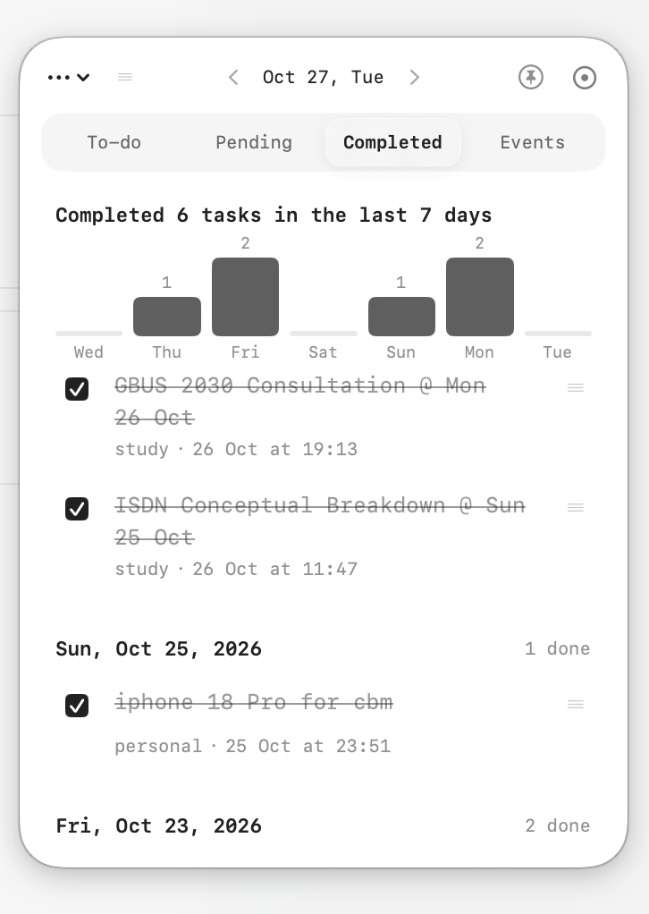
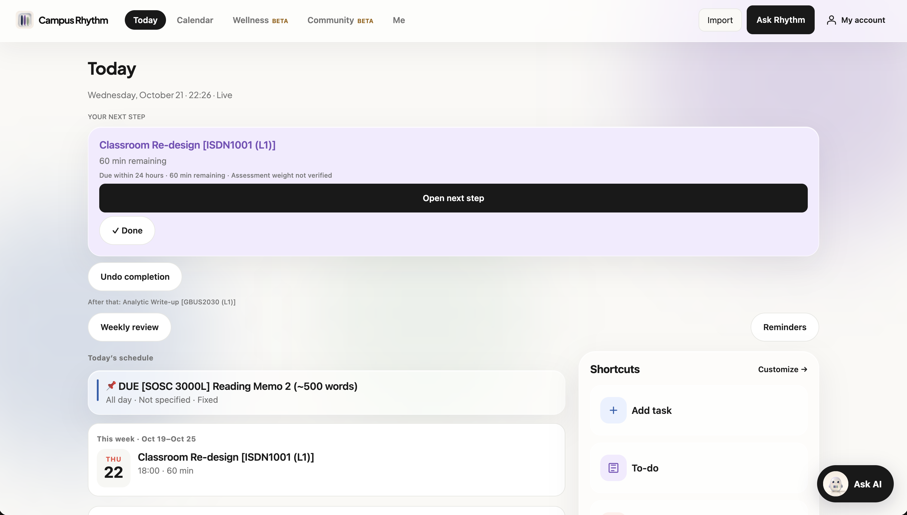
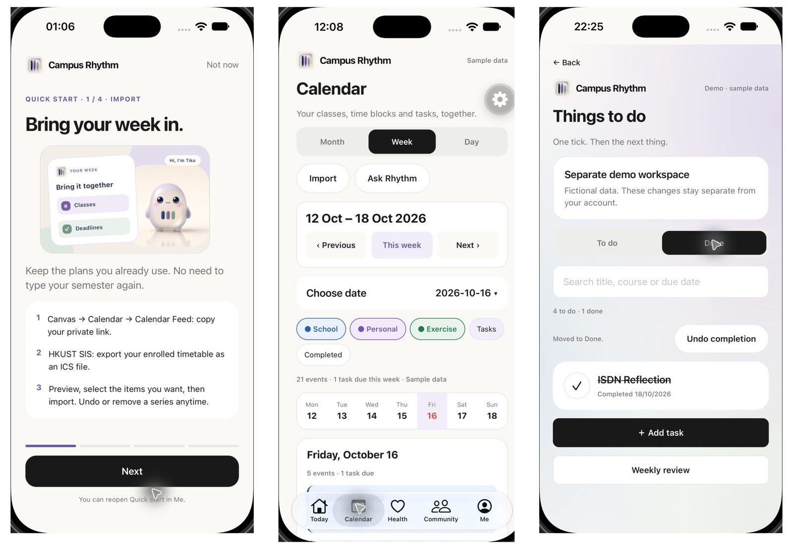
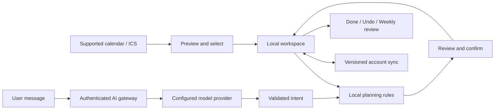

# Campus Rhythm

**Turn scattered commitments into one feasible next step.**

A proactive planner for **web**, **iOS (in development)** and a free **macOS to-do sticker**.

[User guide](GUIDE.md) · [**Campus Rhythm Mini**](docs/CAMPUS_RHYTHM_MINI.md) · [Architecture](docs/ARCHITECTURE.md) · [Evaluation](docs/EVALUATION.md) · [Roadmap](docs/ROADMAP.md)

**Web prototype · iOS dev build · Campus Rhythm Mini v0.9.37 · Updated 27 October 2026**

⭐ If the macOS **to-do sticker** helps your day, please **[star this repo](https://github.com/jinghengxu74/campus-rhythm-app/stargazers)** and **[star campus-rhythm-mini](https://github.com/jinghengxu74/campus-rhythm-mini/stargazers)** so more students can find it.

Campus Rhythm brings commitments into a shared calendar, suggests a useful next action, and helps you record what actually gets done. A deadline tells you **when work is due**; a work session tells you **when you will do it**. The product keeps those two things separate.

Started at HKUST, with students as the first audience. The longer-term direction is everyday planning for people with tight schedules; usefulness beyond students still needs validation.

> This is the public **product showcase** and documentation repository. The full web/iOS application source is private. **Campus Rhythm Mini** (macOS to-do sticker) is **open source** and downloadable below.

## Platforms at a glance

| Platform | Status | Get it |
| --- | --- | --- |
| **Web** | Working prototype on Vercel | [campus-rhythm-one.vercel.app](https://campus-rhythm-one.vercel.app) |
| **iOS** | Development build (not App Store / TestFlight) | Follow the [user guide](GUIDE.md); native widgets need a dev build |
| **macOS — Campus Rhythm Mini** | Free open-source **to-do sticker** (menu bar + glass note) | [**Download zip**](assets/downloads/Campus-Rhythm-Mini-macOS-arm64-v0.9.37.zip) · [**Source**](https://github.com/jinghengxu74/campus-rhythm-mini) · [install guide](docs/CAMPUS_RHYTHM_MINI.md) |

## See the product

### macOS — Campus Rhythm Mini (*Campus Resume Sticker*)

*macOS screenshot supplied by the project owner, 27 October 2026. The menu-bar sticker folds to a circle, syncs optional Daily notes with the web app, and keeps completion history on device.*

**Campus Rhythm Mini** is a lightweight companion: capture today’s list, drag tasks between days, swipe the completed chart across the last week, and fold the window into a corner while you work. Build from source or use the unsigned Apple silicon build in this repo.

### Web — Today

*Desktop screenshot supplied by the project owner, 21 October 2026. It shows the current interface and example commitments visible in that workspace, not evidence of user outcomes. Open the image for full resolution.*

Today puts the next action above the full schedule. The interface explains the recommendation, exposes completion and undo, and keeps the calendar, imports and task list close by. Unknown assessment weights are explicitly marked as unverified.

### iOS — development preview

*Earlier development screenshots, retained to show the native flow. They are not screenshots of a distributed release. Physical-device HealthKit acceptance and the full native journey remain open.*

## Why Campus Rhythm?

Classes, deadlines and personal plans often live in different places. Copying them into another calendar still leaves the difficult decisions: what matters now, how much preparation remains, and where the work can fit.

Campus Rhythm is built around three decisions:

- **Start with existing commitments.** Preview calendar imports and choose what to save instead of retyping the semester.
- **Make the next step small enough to act on.** Use deadlines, remaining effort, fixed commitments and saved rest preferences to inform planning.
- **Keep the user in control.** Review suggestions before saving, record completion separately from scheduled time, and undo supported changes.

The design goal is lower planning effort. Reduced stress, better grades and improved sleep have not been demonstrated.

## The workflow

**Import → review → plan → confirm → do → reflect**

| Step | What you do | What the product preserves |
| --- | --- | --- |
| Import | Bring in supported Canvas feeds or an ICS class/event export. | A preview before anything is saved. |
| Review | Select items and check dates, timezones and missing details. | Source-derived dates; no invented grade weights. |
| Plan | Add effort estimates and ask Rhythm for help finding time. | A distinction between due dates and work sessions. |
| Confirm | Inspect or edit the proposed change, then save. | Local rule checks and explicit confirmation. |
| Do | Mark a task Done and record progress; undo when needed. | Completion history rather than assuming calendar time was productive. |
| Reflect | Open the weekly review. | A summary based on recorded activity, with missing data left unknown. |

**Illustrative example:** a task needs two hours before Friday, but Thursday contains fixed classes. The intended flow is to review feasible preparation sessions, confirm them, then record actual progress. This example describes the workflow; it is not a measured scheduling benchmark.

## Try it

1. Open the [web app](https://campus-rhythm-one.vercel.app). Use Google/email sign-in for an account workspace, or Local mode where offered.
2. Start with **Import**. Preview a supported calendar feed or `.ics` file, select a small set, and confirm.
3. Open **Today** or **Calendar**. Add a task with a due date and estimated effort, then ask **Rhythm** to help plan it.
4. Review and confirm the draft. Try **Done → Undo → Weekly review** to follow the complete loop.

The [user guide](GUIDE.md) covers first use, imports, planning, recovery and troubleshooting. No developer setup is needed to try the hosted app. Cloning this showcase does not install the application.

## Capabilities and current boundaries

| Area | Current capability | Boundary |
| --- | --- | --- |
| Today and calendar | Next-step view, month/week/day calendar and task navigation. | Recommendations depend on the information entered or imported. |
| Imports | Preview/select/save, reimport deduplication and batch management. | Snapshots, not continuous Canvas or Outlook synchronization. |
| Planning assistant | Natural-language interpretation, local planning rules and reviewed drafts. | Cloud AI needs sign-in and service availability; no autonomous calendar writes. |
| Execution and review | Done, progress, supported undo and weekly review. | Scheduled work is not counted as completed work. |
| Accounts | Supabase authentication and versioned account-plan sync. | Independent new-user and multi-device acceptance remain incomplete. |
| Native surfaces | iOS widget, Live Activity and reminder implementations. | Development build; simulator evidence does not establish physical-device reliability. |
| **macOS sticker** | Open-source **Campus Rhythm Mini** with local notes, optional account sync and completion chart. | Unsigned ad-hoc build; not notarized. Intel Macs are not in the published zip. |
| Wellness | Manual records plus a read-only native Apple Health module. | Real iPhone readings and health-informed scheduling still need acceptance work. Mini does not read Health. |
| Community | Exploratory sharing/community direction. | A complete social scheduling experience is not claimed. |

## How it works

The model interprets a request; local code matches tasks, checks dates and conflicts, and prepares the change for review. The current request payload contains the message, scope and planning date, rather than an automatic upload of the calendar database. Text typed into a cloud-AI message is still transmitted to the configured provider.

| Layer | Technology and role |
| --- | --- |
| Interface | TypeScript, React, Expo SDK 57, Expo Router, React Native and React Native Web. |
| Account data | Supabase Auth and Postgres; row-level security and revision-based writes. |
| AI gateway | Vercel API; server-side provider credentials, authentication and request budgets. OpenRouter integration is implemented. |
| Native integration | HealthKit read module, Expo notifications, widgets and Live Activities. |
| Delivery | Vercel for web/API; Expo native development builds; checks defined in the private source repository. |

See [architecture and trade-offs](docs/ARCHITECTURE.md) for data boundaries, synchronization and the cloud/local distinction.

## Engineering evidence

On **21 October 2026**, the private source checkout at `06cb519` passed **201 automated tests** and TypeScript checking. The standard Expo application lint check is recorded separately in the [evaluation notes](docs/EVALUATION.md). These checks cover implementation behavior; they do not establish product adoption or a security certification.

A documented timetable regression check on **19 October 2026** compared **10 recurring series / 126 occurrences** with a separate reference calculation. This is one real timetable export, not a representative import benchmark or proof of enrollment.

The [evaluation notes](docs/EVALUATION.md) distinguish checks rerun for this documentation update, earlier maintainer verification and unfinished acceptance. The public showcase does not contain the source or a reproducible application test suite.

## Privacy and user control

- Review imports and assistant drafts before saving them.
- Treat calendar feed URLs as private credentials; do not put them in issues or screenshots.
- The native Apple Health read path is separate from account-plan sync and is not automatically sent to cloud AI. Manual wellness records have separate cloud-consent controls.
- Production Health-mode cloud AI is disabled in the reviewed implementation.
- Keep missing readings and unverified grading weights explicit.

Read the [data and privacy boundaries](docs/PRIVACY.md) before connecting calendars or using cloud AI.

## What comes next

The immediate priorities are an unassisted new-student journey, feedback-led simplification, and physical-iPhone acceptance. More seamless reviewed scheduling, health-aware planning and shared-time discovery are later work. See the [roadmap and acceptance criteria](docs/ROADMAP.md); no release dates or pilot outcomes are promised.

## Documentation and feedback

| Resource | Use it for |
| --- | --- |
| [User guide](GUIDE.md) | First use and common problems. |
| [Product brief](docs/PRODUCT.md) | Audience, decisions and intended experience. |
| [Architecture](docs/ARCHITECTURE.md) | System responsibilities and technical trade-offs. |
| [Evaluation](docs/EVALUATION.md) | Dated checks, evidence limits and open validation. |
| [Privacy](docs/PRIVACY.md) | What stays local and what may leave the device. |
| [Roadmap](docs/ROADMAP.md) | Priorities and what would count as done. |
| [**Campus Rhythm Mini**](docs/CAMPUS_RHYTHM_MINI.md) | macOS download, build and privacy. |
| [Changelog](CHANGELOG.md) | Public showcase updates. |

Report reproducible interface problems through [GitHub Issues](https://github.com/jinghengxu74/campus-rhythm-app/issues), or use the optional [feedback survey](https://forms.gle/8ue3LXgotZLrxNzX9). Please remove personal calendar details. See [contribution guidance](CONTRIBUTING.md).

Created by [Jingheng Xu](https://github.com/jinghengxu74). Built with Expo, React Native, Supabase and Vercel, with an OpenRouter integration. Product decisions and verification remain the maintainer's responsibility.

## License

Original documentation and original project artwork in this showcase are available under the [MIT License](LICENSE). Third-party names and marks remain their owners' property. This license does not publish or license the private application source code.
