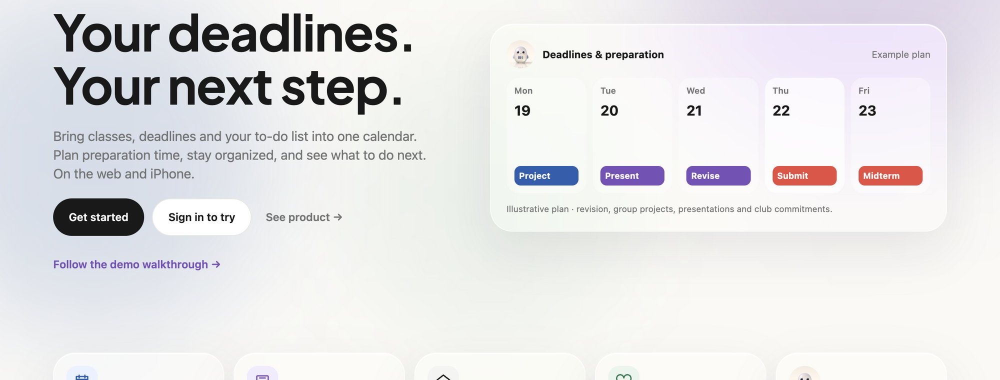
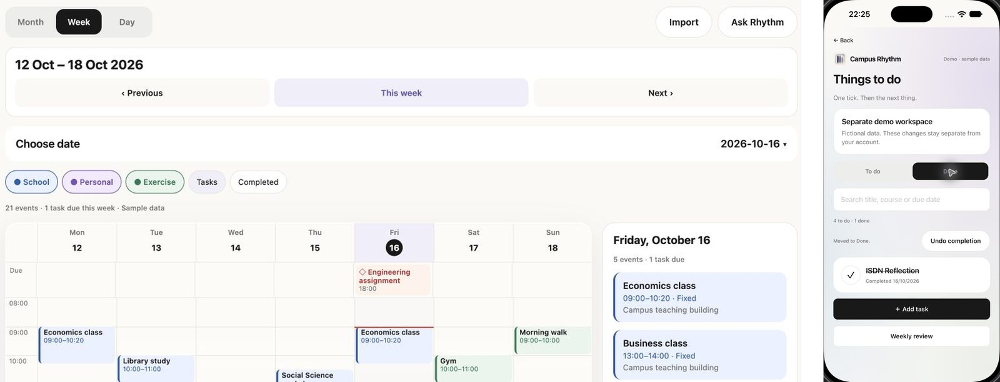
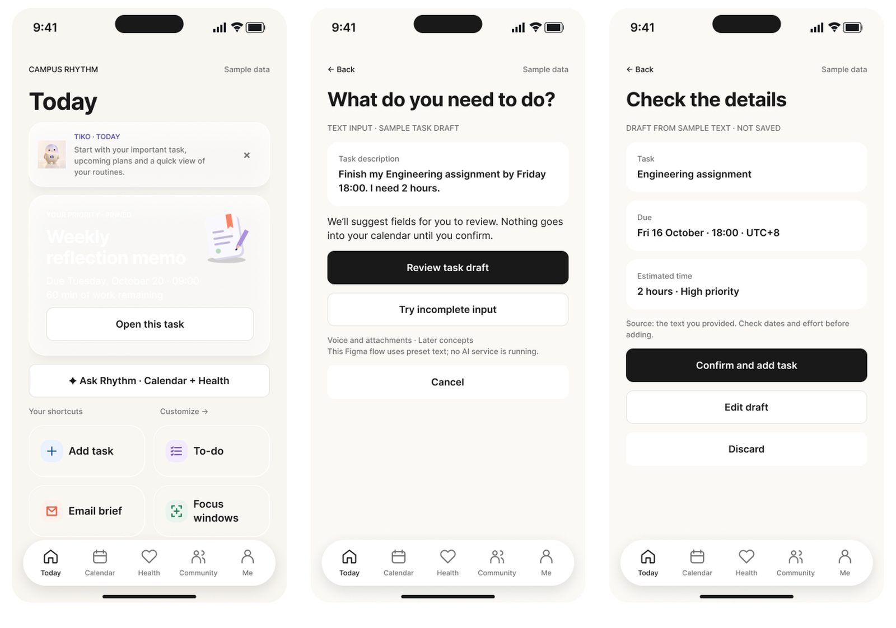
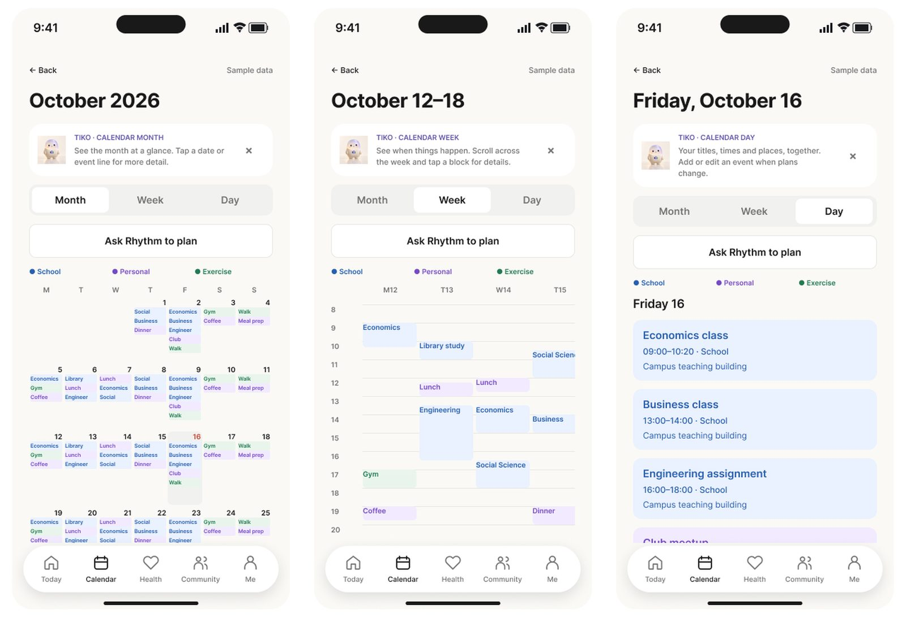
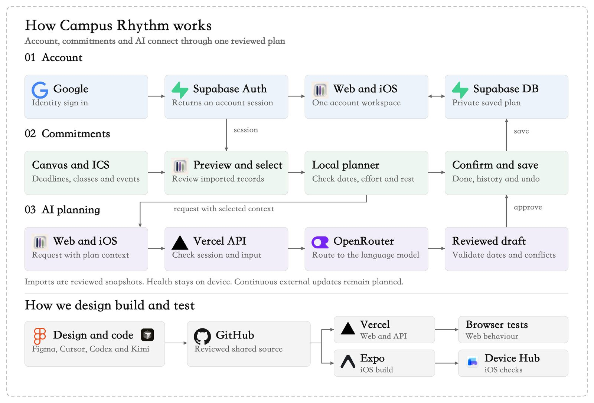

# Campus Rhythm

**A proactive planner for tight schedules — understand your day before it runs you.**

🌐 **Try it live: https://campus-rhythm-one.vercel.app** (web)

📱 **iOS app: in development** (Expo / React Native)

📖 **How to use it: [User Guide](GUIDE.md)**

---

## What is Campus Rhythm?

Campus Rhythm is an **AI-assisted planner that connects your commitments to a feasible next step**. It brings classes, deadlines, events and personal goals into **one reviewed plan**, and builds a rhythm around what you actually do — not just what you planned.

Knowing a deadline is not the same as having time to prepare for it. Campus Rhythm treats a deadline and the work required to meet it as different things, and helps you fit real work into a real day. The goal is proactive life management: understand your day-to-day activities and trends, and act on them before they become problems.

**Started from HKUST**, built for a universal problem: scattered commitments and too little time. Students are the first users — especially those who care about both **time management and health** — and the same loop applies to anyone with a tight schedule, which is why professionals are the natural next audience.

## The core loop: import → plan → do → review

- **Import** — preview Canvas deadlines and class/event calendars (ICS), select what to keep, review before saving. Imports are reviewed snapshots, not blind syncs.
- **Plan** — the AI-assisted planner weighs due dates, remaining effort, fixed commitments and your chosen rest windows. Every suggestion is a **draft you review**; a rule check rejects impossible slots; nothing is saved without your confirmation.
- **Do** — record Done and actual minutes, split heavy tasks into sessions, keep history, and **undo** any change.
- **Review** — weekly reviews based on what you actually did, so the plan follows your real rhythm.

## Product

| Web (live) | iOS (in development) |
|---|---|
|  |  |
| Week/day/month calendar, import preview, to-do with Done & Undo | Onboarding import, calendar, things-to-do |

- **One proactive next step** — Today surfaces the next feasible action based on deadlines, remaining effort and your rest windows.
- **AI drafts, you decide** — ask Rhythm for a suggested time; the draft is validated against fixed classes, rest time and workload before you confirm. The AI never writes to your plan directly.
- **Stay close to the day** — iOS Home Screen widgets, Live Activities and local notifications keep the next step visible.
- **Respect your privacy** — read-only Apple Health (sleep, steps, exercise minutes) stays on device and is not sent to the cloud or the AI.

## How it works

- **Account** — Google/email sign-in via Supabase Auth; one account workspace across web and iOS; row-level security keeps every plan private.
- **Commitments** — Canvas/ICS imports are previewed and selected before saving; dates, effort and rest are checked locally; confirm, history and undo on every change.
- **AI planning** — the web/iOS client sends plan context to a Vercel API, which holds the OpenRouter key **server-side only**; the model returns a draft; a rule check validates dates and conflicts; the user approves; then it saves.
- **Build lane** — design in Figma → reviewed source on GitHub → Vercel (web + API) and Expo (iOS) → browser and device checks.

## Engineering status

- **201 automated tests** passing across calendar logic, imports, planner rules and API behaviour.
- Calendar engine verified against a **real semester timetable**: 10 recurring series / 126 occurrences matched an independent reference calculation exactly.
- Web app deployed on Vercel production with instant rollback; Supabase (Singapore) Postgres with auth and row-level security.
- iOS app built with Expo / React Native + TypeScript; currently in development.

## Honest status & limitations

Campus Rhythm is a working prototype, not an App Store release.

- ✅ Live web product with sign-in, import, planning, Done/Undo and weekly review.
- 🔄 iOS app in development — not yet distributed; on-device Apple Health reading is implemented but pending verification on a real iPhone.
- 🔄 Real-user pilot just starting — feedback is collected through a short in-app survey; no outcome claims (reduced stress, better grades, fewer missed deadlines) are made until pilot data exists.
- ⏳ Continuous external sync (Outlook, live Canvas updates) is planned, not shipped.

## Roadmap — what we're working on

1. **Simplify the user experience and functions** — fewer steps from commitment to next step; a cleaner first page.
2. **Seamless AI features** — an agent that helps you schedule proactively: turn "finish my Engineering assignment by Friday" into reviewed, feasible sessions without form-filling.
3. **Health schedule** — deeper Apple Health integration so sleep and recovery genuinely constrain what's suggested.
4. **Community / social schedule** — plan around friends, club commitments and shared time, not just solo tasks.
5. **Pilot programme** — 5 students complete the full journey unassisted → audit 30 AI planning scenarios → 20–30 student pilot. Measured by planning time, follow-through and unwanted alerts — not promises.

## Feedback

Found something confusing? The short in-app survey (~4 minutes) directly shapes the next iteration: **https://forms.gle/8ue3LXgotZLrxNzX9**

## License

Project introduction, screenshots and guide: MIT. Product source code is not published in this repository.
