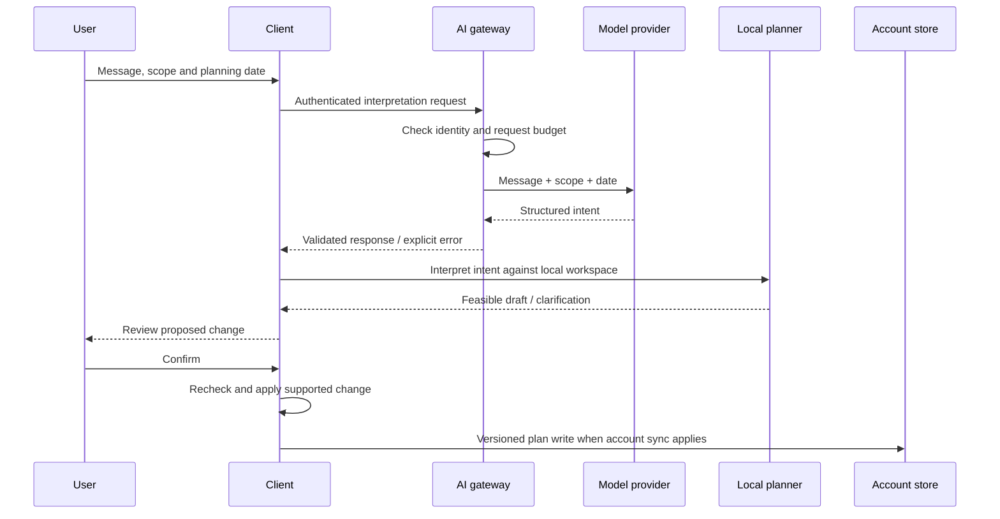

# Architecture and trade-offs

[Overview](../README.md) · [Privacy](PRIVACY.md) · [Evaluation](EVALUATION.md)

Reviewed against private source version 1.1.0 at `06cb519`, 21 October 2026. This is a public system overview, not an operational runbook or public API contract.

## Responsibilities

| Component | Responsibility | Boundary |
| --- | --- | --- |
| Expo client | Routes, calendar, workspace state, local rules, drafts, completion and review. | Web and native share much of the implementation; native capabilities have platform-specific code. |
| Calendar import | Parse supported ICS/feed records, expand supported recurrence and prepare a selection preview. | Imported data is a snapshot. Source enrollment, current rubric and assessment weights are not inferred. |
| Vercel feed endpoint | Fetch approved calendar-feed sources with limits. | Not an unrestricted URL proxy or general calendar subscription service. |
| Supabase | Identity and account data, per-user row-level security, revision-aware writes. | Client state is not proof that a remote write succeeded. |
| Vercel AI endpoint | Authenticate, enforce a request budget and call a configured provider. | Provider credentials remain server-side. It does not directly modify calendar records. |
| Local planner | Match tasks, calculate slots and validate supported proposed changes. | Results depend on available data and supported constraints. |
| Native surfaces | Widget timelines, focus Live Activity, local reminders and HealthKit read bridge. | Physical-device behavior requires separate acceptance. |

## Planning and AI

The reviewed client request contains `text`, `scope` and `date`. It does not automatically attach the stored calendar or health diary. A message can itself contain a task title or other private information; that text is transmitted when cloud AI is used.

OpenRouter integration is implemented in the server. Model/provider availability and quotas are deployment configuration, not product guarantees. The local planner remains a separate path and should be labelled accordingly. Production Health-mode model requests are rejected in the reviewed implementation.

## Synchronization

The account store uses versioned snapshots and a revision/compare-and-swap write contract. Clients refresh through polling and lifecycle/connectivity events. This is not described as a realtime subscription system.

Revision checks allow stale writes to be detected rather than silently overwriting newer data. Workspace-generation checks prevent delayed callbacks from a previous account or demo session writing into the current workspace. Account, Local and demo modes must remain distinguishable.

Plan payloads include events, tasks, goals and relevant preferences. They do not automatically include chat history or native Apple Health readings. Manual wellness records have a separate optional cloud payload and consent path.

## Imports and time

Preview and selection precede saving. Supported recurring imports retain source exceptions; reimports use stable identity/deduplication behavior and preserve supported user edits. Dates without a time remain distinct from timed sessions.

Regression work covers date-only recurrence exclusions, timezone conversion, midnight boundaries and ISO-year formatting. These tests do not establish support for every ICS producer or timezone scenario. The documented 126-occurrence comparison used a single HKUST timetable preview export.

## Native health

The HealthKit module requests read access to sleep analysis, step count and exercise time, with no write types. Native readings are summarized through a separate connection controller. Account changes and lifecycle changes invalidate stale reads. The reviewed connection retains the reading choice separately and keeps the reading summary outside the cloud-plan payload.

Manual health diaries are a different feature with different consent controls. Avoid the broader claim that every health-related field always stays on device. Real HealthKit readings and useful health-constrained scheduling remain acceptance work.

## Design trade-offs

| Choice | Benefit | Cost / remaining work |
| --- | --- | --- |
| Shared web/native client | Reuse of state and planning rules. | Safe areas, native navigation and device integrations still need platform testing. |
| Snapshot imports | Explicit review and a bounded import operation. | External edits can leave the plan stale until a reviewed reimport. |
| Structured intent plus local rules | Model interpretation is separated from calculations and writes. | Complex requests can require clarification or exceed supported intents. |
| Explicit confirmation | Makes proposed changes inspectable. | Adds friction; simplification must preserve user control. |
| Versioned snapshots | Detects stale writes without a larger event infrastructure. | Conflict handling and multi-device recovery need continued acceptance. |
| Private source / public showcase | Separates public product documentation from implementation. | Readers cannot reproduce the application tests from this repository. |

## Verification boundary

The source repository defines tests, type checking, Expo lint and a web export workflow. The existence of a workflow is not proof that the latest remote run passed. See [dated verification](EVALUATION.md) for what was rerun and what remains unverified.
