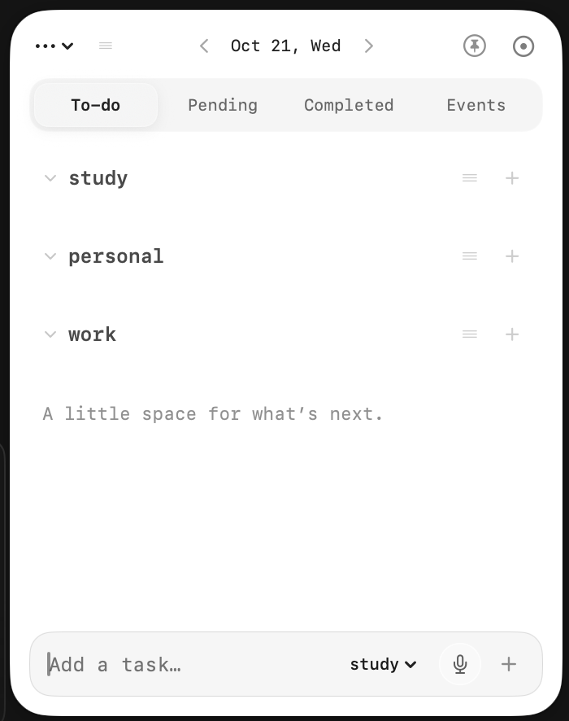
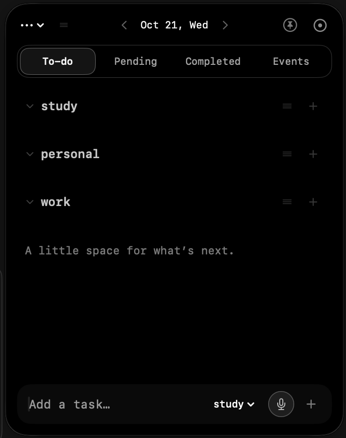
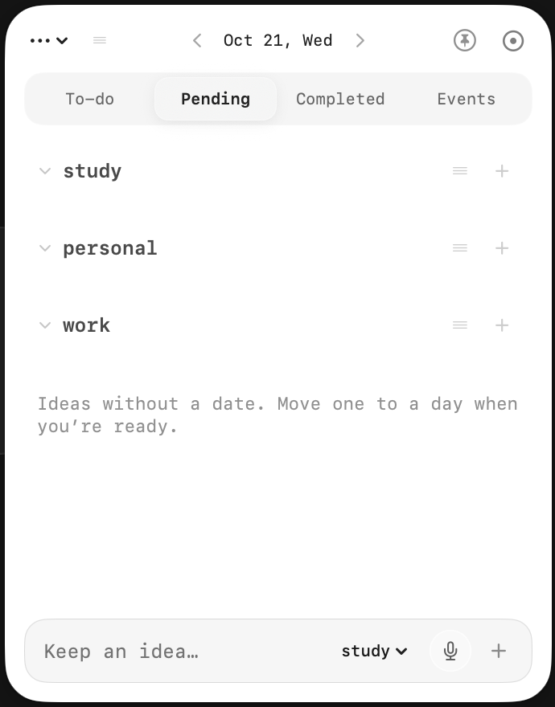
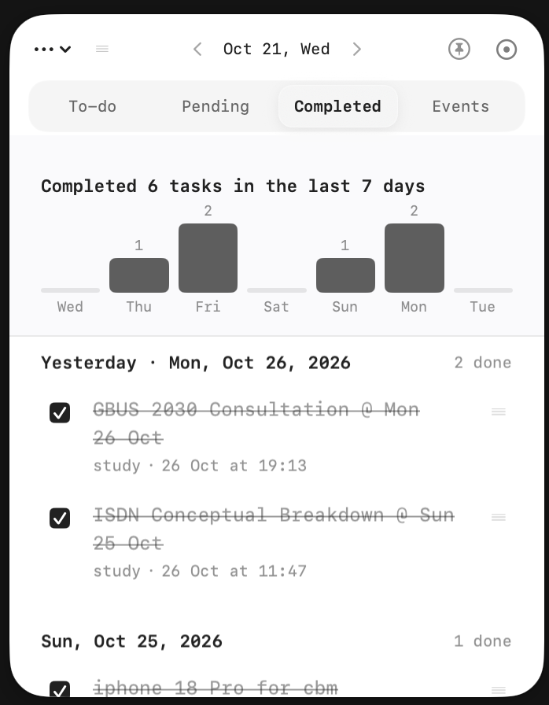
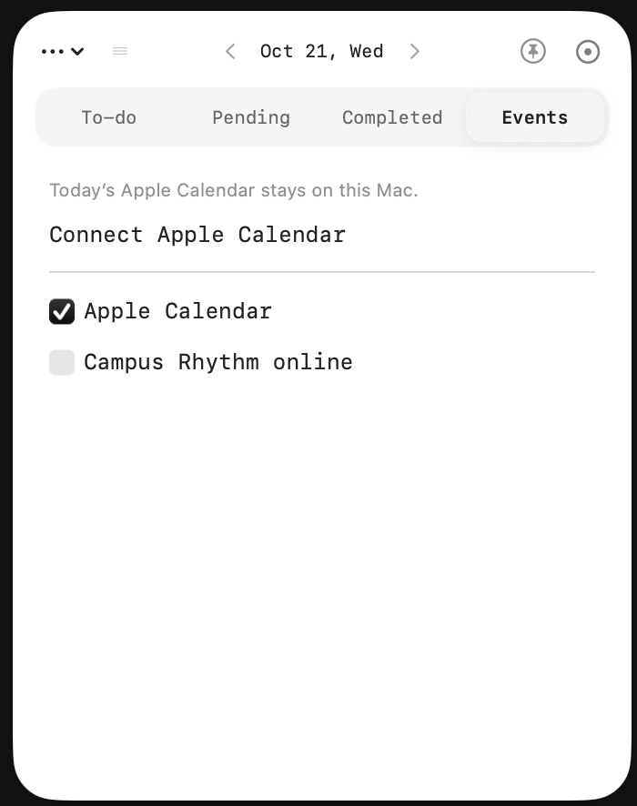
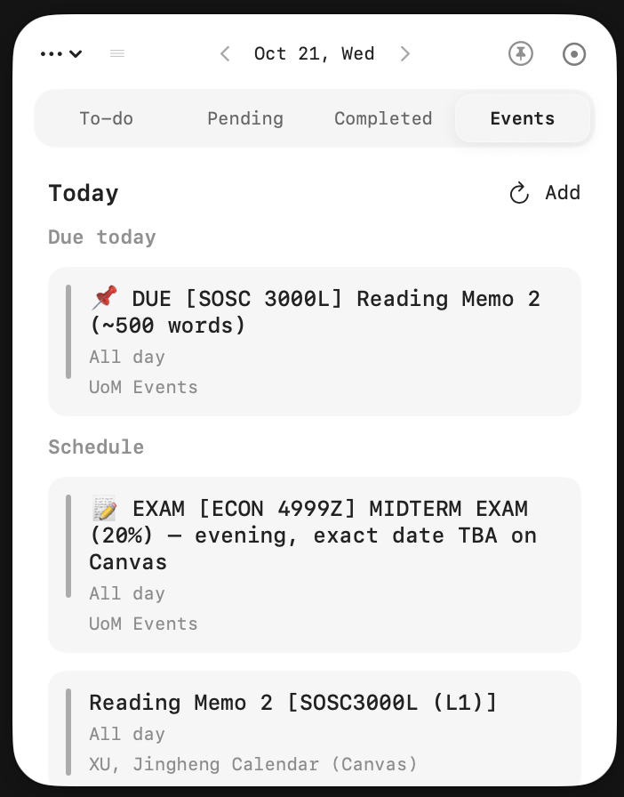

# Campus Rhythm To-Do Notes · macOS desktop sticker

**Campus Rhythm To-Do Notes** is the public name for the floating Mac companion (also called **Campus Rhythm Sticker**). The menu-bar app title may still show **Rhythm Note** on disk (`Campus Rhythm Mini.app`); that bundle name keeps existing local data paths working.

## Download

| | |
| --- | --- |
| **Apple silicon zip** | [Campus-Rhythm-To-Do-Notes-macOS-arm64-v0.9.58.zip](https://github.com/jinghengxu74/campus-rhythm-mini/releases/latest/download/Rhythm-Note-macOS-arm64.zip) |
| **Source (MIT)** | [github.com/jinghengxu74/campus-rhythm-mini](https://github.com/jinghengxu74/campus-rhythm-mini) |
| **Releases** | [Latest GitHub release](https://github.com/jinghengxu74/campus-rhythm-mini/releases/latest) |

macOS **13+**, unsigned ad-hoc build. First open: right-click → **Open**, or allow once in **Privacy & Security**.

Full privacy write-up: **[PRIVACY_TODO_NOTES.md](PRIVACY_TODO_NOTES.md)** · Fork: **[FORK.md](FORK.md)**

## Your data stays on this Mac (by default)

| What | Where it goes |
| --- | --- |
| **Tasks, categories, completion history, appearance** | `~/Library/Application Support/CampusRhythmMini/` on your Mac only |
| **Apple Calendar (Events tab)** | Read on device when you enable **Apple Calendar**; not uploaded to Campus Rhythm servers |
| **Campus Rhythm account** | **Optional.** Nothing is sent to the cloud until you choose **… → Connect account** and sign in |
| **Rhythm assistant** | Only when you open it; cloud AI requires the same optional account and your message text |

Disconnect account to return to device-only notes. Import merges local notes into an account only when you confirm.

## Check for updates (in the app)

Open **…** (top-left menu) → **Check for updates…** — opens the latest [GitHub release](https://github.com/jinghengxu74/campus-rhythm-mini/releases/latest). Download the new zip and replace the app when you choose to upgrade.

## Four tabs

### To-do

Day-scoped tasks for the date in the header (`< Oct 21, Wed >`). Categories (study, personal, work), drag reorder, per-task colors. Tasks carry forward until you **Mark complete**. Completed tab includes a 7-day chart (two-finger horizontal scroll) and tap-a-day to jump the done list.





### Pending

Undated inbox — ideas without a fake due date. Move to today, tomorrow or the selected day from the context menu.



### Completed

Confirmed completions grouped by day, plus a **seven-day bar chart** (trackpad swipe left/right through the last week). Tick to cross out, then **Mark complete** to archive.



### Events

See **today’s schedule** on the Mac: Apple Calendar entries and, when connected, **Campus Rhythm online** plan events for that day. Toggle sources at the top; refresh when your account is linked.





## Floating on your desktop

- **Pin** keeps the note above other windows.
- **Fold into circle** (menu or control) shrinks to a draggable dot; click to unfold.
- **Resize** from the corner; **multiple windows** for different days.


## Build from source

```sh
git clone https://github.com/jinghengxu74/campus-rhythm-mini.git
cd campus-rhythm-mini
zsh scripts/test.sh && zsh scripts/build.sh
open dist/Campus\ Rhythm\ Mini.app
```
